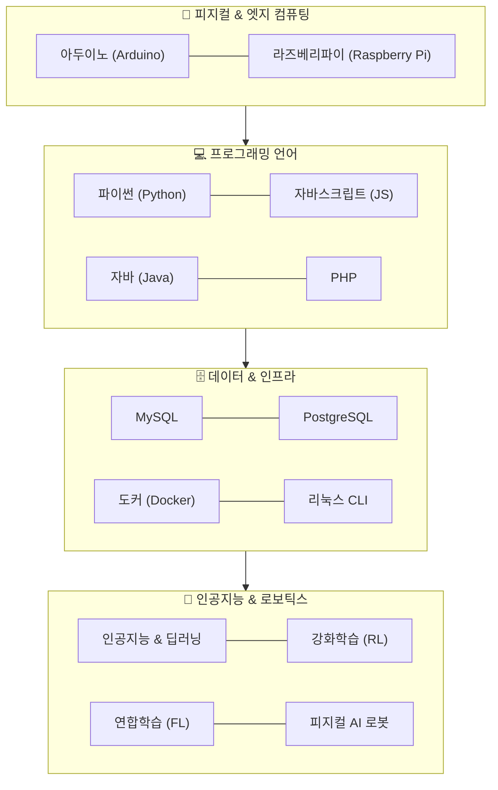
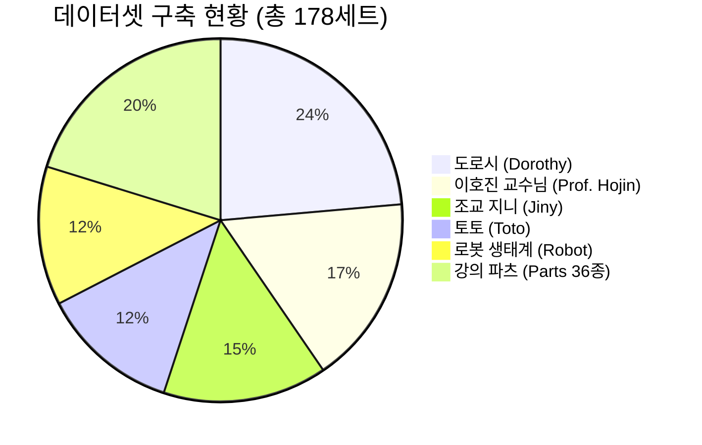

# 🌟 도로시(Dorothy)의 컴퓨팅 과학 & AI 모험

> **"호기심에서 시작해 인공지능과 세상을 잇는 따뜻한 메이커들의 성장 스토리"**  
> 도로시, 이호진 교수님, 조교 지니, 그리고 반려견 토토가 함께 아두이노부터 딥러닝, 강화학습, 피지컬 AI 로보틱스까지 컴퓨팅 과학의 방대한 바다를 탐험하며 성장해 나가는 **프리미엄 2D 교육 스토리텔링 프로젝트**입니다.

---

## 📖 1. 프로젝트 개요 (Overview)

**`Dorothy` 프로젝트**는 딱딱하고 추상적인 컴퓨터 과학(CS)과 인공지능(AI) 지식을 스튜디오 지브리 감성의 따뜻하고 생동감 넘치는 2D 애니메이션 일러스트레이션으로 풀어내는 교육 콘텐츠 & 캐릭터 세계관 저장소입니다.

* **강의와 교재를 위한 표준 시각화:** 책, 웹 튜토리얼([`jinysite`](file:///Users/hojin9/dev/jinysite)), 슬라이드 강의 자료에 일관된 캐릭터와 화풍을 제공합니다.
* **자립형 프롬프트 엔진:** 단 하나의 마스터 프롬프트 파일([`prompt.md`](file:///Users/hojin9/dev/projects/dorothy/prompt.md))을 Gemini 등 생성형 AI에 전달하는 것만으로 완벽하게 동일한 유형의 고품질 교육 삽화를 생성할 수 있습니다.
* **완결된 고품질 LoRA 데이터셋:** 캐릭터 5인방과 36종 강의 파츠(환경, 하드웨어, 소프트웨어, AI 이론, 로고) 등 총 **178세트**의 고해상도 이미지와 이중 레이어 캡션(`.txt`)이 구축되어 있습니다.

---

## 👥 2. 캐릭터 및 로봇 세계관 (The Characters & Ecosystem)

모든 캐릭터는 고유의 시각 규격, 페르소나, 그리고 14대 컴퓨터 과학 영역별 역할 매트릭스를 지니고 있습니다.

| 캐릭터 | 역할 / 페르소나 | 비주얼 규격 & 핵심 특징 | 대표 상호작용 & 역할 |
| :--- | :--- | :--- | :--- |
| **👧 도로시 (Dorothy)** | **호기심 넘치는 주니어 메이커**<br>실패를 두려워하지 않는 당찬 소녀 코더 | • 밤갈색 웨이브 양갈래 머리 (구슬 방울 끈)<br>• 주황 줄무늬 티 & "STEM HERO" 데님 오버롤<br>• 비비드 레드 캔버스 스니커즈 (4.5등신) | 아두이노 센서 실험, 파이썬 코딩, 직접 만든 AI 모델을 실생활에 적용하며 성장하는 주인공 |
| **👨‍🏫 이호진 교수님 (Prof. Hojin)** | **지적이고 친근한 AI/공학 멘토**<br>스티브 잡스 스타일의 실용적 혁신가 | • 40대 초반 동안(매끈한 피부, 주름 없음)<br>• 솔트앤페퍼 숏헤어 & 슬림 와이어 안경<br>• 무지 다크 네이비 폴로 + 블루진 + 뉴발란스 | 개념의 원리와 흐름을 명쾌하게 짚어주는 나침반. 수식·알고리즘·강화학습 아키텍처의 길잡이 |
| **🐱 조교 지니 (Jiny)** | **이호진 교수님의 수석 연구실 조교**<br>시크하면서도 똑똑한 츤데레 냥이 | • 한국 단모종 턱시도/젖소 무늬 코숏<br>• 핑크 단추 코 & 지적인 올리브 그린 눈<br>• 레드 방울 목걸이 & 미니 조교 안경 | 코드 디버깅 감수, 회로 핀 연결 오류를 앞발로 콕 짚어주며 모니터 앞이나 회로도 위에서 식빵 굽기 |
| **🐶 토토 (Toto)** | **도로시의 단짝 반려견 & 마스코트**<br>지치지 않는 비타민이자 현장 조수 | • 복슬복슬 단색 웜밀크 화이트 (`#FBF6EB`)<br>• 얼룩/반점 전혀 없음, 검은 단추 코 & 단추 눈<br>• 산뜻한 하늘색(Sky-blue) 삼각 반다나 | 점퍼 와이어와 작은 부품을 물어다 주는 귀여운 조수. 도로시에게 무한한 용기와 격려 제공 |
| **🤖 로봇 생태계 (Tinny & Robotics)** | **피지컬 AI 협력자 & 로보틱스**<br>함께 만들고, 일하고, 학습하는 동반자 | • 틴맨(Tinny): 2족보행 양철 휴머노이드<br>• 6축 산업용/교육용 협동 로봇 암<br>• 3축 직교 갠트리 & SCARA 로봇 | 아두이노·라즈베리파이 센서 모터 제어, 강화학습 보행 훈련, 디지털 트윈 및 스마트 팩토리 실습 |

### 🎬 연출 및 캐스팅 골든 룰 (Casting Rules)
1. **도로시 + 토토:** 언제나 함께 다니는 단짝 콤비 (기본 씬 구성)
2. **이호진 교수님 & 조교 지니의 등장 시점:** 새로운 지식을 가르치거나, 디버깅 힌트를 주거나, 원리를 설명할 때 등장
3. **씬당 개체 수 제한:** 한 장면에 고양이(지니) 1마리 + 강아지(토토) 1마리를 초과하여 등장하지 않음 (단일 개체 원칙)
4. **언어 제한:** 모든 칠판 판서, 모니터 텍스트, 라벨은 **한국어(한글) 또는 영어**만 사용 (일본어 절대 금지)

---

## 🚀 3. 탐구 및 강의 영역 (14대 컴퓨팅 커리큘럼)

캐릭터들은 피지컬 임베디드부터 분산 인공지능, 현대 클라우드 인프라까지 전방위 기술을 실전 프로젝트로 탐구합니다:



* **🔌 피지컬 & 엣지 컴퓨팅:** 아두이노 센서·모터 C++ 제어, 라즈베리파이 리눅스 엣지 AI 노드
* **💻 프로그래밍 언어:** 파이썬(데이터·PyTorch), 자바스크립트(반응형 웹), 자바(OOP 원칙), PHP(웹 MVC 아키텍처)
* **🗄️ 데이터 & 인프라:** MySQL & PostgreSQL(정규화, ACID, JSONB, 인덱스 최적화), 도커(컨테이너화), 리눅스 CLI(Bash)
* **🧠 인공지능 & 피지컬 AI:** 딥러닝(신경망·CNN), 강화학습(MDP·벨만 방정식·정책 최적화), 연합학습(분산 프라이버시 AI), 협동 로봇 자율 제어

---

## 📚 4. 마스터 스타일 가이드 (`guides/`)

캐릭터의 외형 규격, 안티 패턴, 컬러 팔레트, 성격 페르소나 및 14대 기술 매트릭스가 캐릭터별 마스터 가이드에 통합 수록되어 있습니다:

| 가이드 문서 | 대상 | 핵심 수록 내용 |
| :--- | :--- | :--- |
| 👧 **[`DOROTHY_STYLE_GUIDE.md`](file:///Users/hojin9/dev/projects/dorothy/guides/DOROTHY_STYLE_GUIDE.md)** | 도로시 | 4.5등신 조형 규격, 4대 헤어스타일, 4대 의상, 주니어 메이커 페르소나 & 14대 학습 매트릭스 |
| 👨‍🏫 **[`HOJIN_STYLE_GUIDE.md`](file:///Users/hojin9/dev/projects/dorothy/guides/HOJIN_STYLE_GUIDE.md)** | 이호진 교수님 | 40대 초반 동안 앵커(노안 방지), 무지 네이비 폴로, 슬림 안경, 스티브 잡스형 멘토링 매트릭스 |
| 🐱 **[`JINY_STYLE_GUIDE.md`](file:///Users/hojin9/dev/projects/dorothy/guides/JINY_STYLE_GUIDE.md)** | 조교 지니 | 한국 단모종 턱시도, 올리브 눈, 핑크 코, 미니 안경, 레드 방울 목걸이, 코드리뷰 매트릭스 |
| 🐶 **[`TOTO_STYLE_GUIDE.md`](file:///Users/hojin9/dev/projects/dorothy/guides/TOTO_STYLE_GUIDE.md)** | 토토 | 안티 드리프트 엔진(단색 웜밀크 화이트, 얼룩 없음, 검은 코/눈), 하늘색 반다나, 하드웨어 보조 매트릭스 |
| 🤖 **[`ROBOT_STYLE_GUIDE.md`](file:///Users/hojin9/dev/projects/dorothy/guides/ROBOT_STYLE_GUIDE.md)** | 로봇 생태계 | 틴맨(휴머노이드), 6축 협동로봇, 3축 직교 갠트리, SCARA 로봇, 피지컬 AI 협업 매트릭스 |
| 🧩 **[`PARTS_AND_LORA_TRAINING_GUIDE.md`](file:///Users/hojin9/dev/projects/dorothy/guides/PARTS_AND_LORA_TRAINING_GUIDE.md)** | 파츠 & LoRA | 36종 강의 파츠(환경, 하드웨어, 소프트웨어, AI 이론, 로고) 명세 및 Multi-Concept LoRA 학습 레시피 |

---

## 🎨 5. 제미나이(Gemini) 마스터 프롬프트 엔진 (`prompt.md`)

[`prompt.md`](file:///Users/hojin9/dev/projects/dorothy/prompt.md)는 **외부 파일 참조 없이 단독으로 Gemini LLM / 생성형 이미지 모델에 입력하여 완벽한 일관성의 교육 일러스트를 출력하는 단일 마스터 프롬프트 엔진**입니다.

### 5블록 프롬프트 공식 (The 5-Block Formula)
```text
[Block 1: Master Style Core (Ghibli 2D, soft clean lines, cel shading, no 3D)]
+ [Block 2: Character Anchor (Dorothy / Hojin / Jiny / Toto / Robot exact visual tokens)]
+ [Block 3: Scene & Technology Interaction (Arduino, PyTorch, Docker, RL Blackboard, etc.)]
+ [Block 4: Lighting & Atmospheric Composition (Golden hour, warm amber glow, clean depth)]
+ [Block 5: Negative Guardrail (No Japanese characters, no 3D render, no wrinkles on Hojin, no spots on Toto)]
```

[`prompt.md`](file:///Users/hojin9/dev/projects/dorothy/prompt.md) 내에는 **즉시 복사하여 사용할 수 있는 6대 실전 프로덕션 레시피**가 탑재되어 있습니다:
1. 도로시의 아두이노 초음파 센서 회로 브레드보드 실습
2. 이호진 교수님의 딥러닝 다층 신경망(MLP) 칠판 강의
3. 도로시와 조교 지니의 파이썬 알고리즘 디버깅
4. 도로시와 토토의 라즈베리파이 엣지 AI 객체 인식
5. 도로시의 도커 컨테이너 빌드 성공 환호
6. 이호진 교수님과 틴맨(로봇)의 강화학습 2족보행 훈련

---

## 🎯 6. 교육 및 LoRA 학습 데이터셋 현황 (`data/`)

모든 데이터는 1024x1024 고해상도 정방형 이미지와 Danbooru 태그 + 자연어 설명이 결합된 이중 레이어 캡션(`.txt`)이 **1:1로 100% 매칭**되어 보관됩니다.



### ① 캐릭터 데이터셋 (`data/dataset/`)
| 캐릭터 | 완성 세트 (이미지 / .txt) | 주요 구성 내용 | 저장 디렉토리 |
| :--- | :---: | :--- | :--- |
| **👧 도로시 (Dorothy)** | **42 / 42 세트 (100%)** | 턴어라운드 시트, 다각도 표정, 4대 헤어, 4대 의상, 코딩, 납땜, 브레드보드, 칠판 수식, 성공 환호 | [`data/dataset/dorothy/`](file:///Users/hojin9/dev/projects/dorothy/data/dataset/dorothy/) |
| **👨‍🏫 이호진 교수님** | **30 / 30 세트 (100%)** | 턴어라운드 시트, 40대 초반 동안 앵커, 멘토링, 랩 강의, 엄지 척, 칠판 수식, 로봇 조립 지도 | [`data/dataset/hojin/`](file:///Users/hojin9/dev/projects/dorothy/data/dataset/hojin/) |
| **🐱 조교 지니 (Jiny)** | **26 / 26 세트 (100%)** | 캐릭터 시트, 턱시도 코숏, 조교 안경, 랩 어시스턴트, 식빵 굽기, 모니터 앞 키보드 점령, 코드 감수 | [`data/dataset/jiny/`](file:///Users/hojin9/dev/projects/dorothy/data/dataset/jiny/) |
| **🐶 토토 (Toto)** | **22 / 22 세트 (100%)** | 턴어라운드 시트, 단색 웜밀크 화이트, 하늘색 반다나, 점퍼 와이어 물기, 미어캣 포즈, 기어 냄새 맡기 | [`data/dataset/toto/`](file:///Users/hojin9/dev/projects/dorothy/data/dataset/toto/) |
| **🤖 로봇 생태계 (Robot)** | **22 / 22 세트 (100%)** | 틴맨(휴머노이드 프로필, 관절, 하이파이브), 6축 협동로봇 암, 3축 직교 갠트리, SCARA 조립 로봇 | [`data/dataset/robot/`](file:///Users/hojin9/dev/projects/dorothy/data/dataset/robot/) |

### ② 강의 파츠 & 이론 데이터셋 (`data/dataset/parts/`)
| 카테고리 | 등록 수 | 대표 애셋 구성 | 저장 디렉토리 |
| :--- | :---: | :--- | :--- |
| **🏫 환경 (Environments)** | **6종** | 공학 강의실, 메이커 공방, 코딩 워크스테이션, 팹랩 3D 프린팅 룸, 엣지 AI 룸, 캠퍼스 잔디 | [`data/dataset/parts/01_environments/`](file:///Users/hojin9/dev/projects/dorothy/data/dataset/parts/01_environments/) |
| **🔌 하드웨어 (Hardware)** | **8종** | 아두이노 우노, 라즈베리파이 4, 브레드보드 회로, 초음파 센서, 온습도 센서, 서보 모터, DC 기어 모터, RC 카 | [`data/dataset/parts/02_hardware/`](file:///Users/hojin9/dev/projects/dorothy/data/dataset/parts/02_hardware/) |
| **💻 소프트웨어 (Software)** | **6종** | 자바 OOP 다이어그램, PHP MVC 아키텍처, DB ERD 스키마, 도커 컨테이너, 웹 원격 대시보드, REST API | [`data/dataset/parts/03_software/`](file:///Users/hojin9/dev/projects/dorothy/data/dataset/parts/03_software/) |
| **🧠 AI 이론 (AI Theory)** | **6종** | 다층 신경망(MLP), CNN 합성곱 특성 추출, 강화학습 MDP 루프, 칠판 벨만 방정식, 연합학습 노드, 손실 곡선 | [`data/dataset/parts/04_ai_theory/`](file:///Users/hojin9/dev/projects/dorothy/data/dataset/parts/04_ai_theory/) |
| **🏷️ 공식 로고 (Logos)** | **10종** | 파이썬, C/C++, 자바, PHP, JS/TS, 러스트, 리눅스, 아두이노, 파이토치, 도커 2D 지브리 재해석 로고 | [`data/dataset/parts/05_logos/`](file:///Users/hojin9/dev/projects/dorothy/data/dataset/parts/05_logos/) |

---

## 📂 7. 디렉토리 구조 (Directory Structure)

본 저장소는 불필요한 빌드 스크립트나 임시 파일을 일체 배제하고, **강의 및 출판에 필요한 마스터 가이드(`guides/`)와 정제된 데이터셋(`data/`)** 중심으로 단정하게 구성되어 있습니다:

```text
dorothy/
├── README.md                      # 🌟 프로젝트 총괄 개요 및 세계관 가이드 (본 문서)
├── prompt.md                      # 🎨 제미나이(Gemini) 단일 마스터 프롬프트 실행 엔진
├── guides/                        # 📚 6대 마스터 스타일 & 페르소나 가이드라인
│   ├── DOROTHY_STYLE_GUIDE.md     # 👧 도로시 스타일, 4대 헤어/의상, 주니어 메이커 페르소나
│   ├── HOJIN_STYLE_GUIDE.md       # 👨‍🏫 이호진 교수님 스타일, 40대 초반 동안 규격, 멘토링 매트릭스
│   ├── JINY_STYLE_GUIDE.md        # 🐱 조교 지니(고양이) 스타일, 턱시도 규격, 코드리뷰 매트릭스
│   ├── TOTO_STYLE_GUIDE.md        # 🐶 토토(강아지) 스타일, 안티 드리프트 웜밀크 규격, 하드웨어 조수
│   ├── ROBOT_STYLE_GUIDE.md       # 🤖 틴맨 & 로보틱스 생태계, 피지컬 AI 협업 매트릭스
│   └── PARTS_AND_LORA_TRAINING_GUIDE.md # 🧩 36종 강의 파츠 명세 및 Multi-Concept LoRA 학습 가이드
└── data/
    ├── dataset/                   # 🎯 고해상도(1024x1024) 이미지 + .txt 캡션 1:1 학습 세트 (총 178세트)
    │   ├── dorothy/               # 👧 도로시 데이터셋 (42세트)
    │   ├── hojin/                 # 👨‍🏫 이호진 교수님 데이터셋 (30세트)
    │   ├── jiny/                  # 🐱 조교 지니 데이터셋 (26세트)
    │   ├── toto/                  # 🐶 토토 데이터셋 (22세트)
    │   ├── robot/                 # 🤖 로봇 생태계 데이터셋 (22세트)
    │   └── parts/                 # 🧩 36종 강의 파츠 (36세트)
    │       ├── 01_environments/   # 강의실, 팹랩, 서버룸 등 6종
    │       ├── 02_hardware/       # 아두이노, 라즈베리파이, 센서 등 8종
    │       ├── 03_software/       # OOP, MVC, ERD, Docker 등 6종
    │       ├── 04_ai_theory/      # 신경망, CNN, 강화학습, 벨만 등 6종
    │       └── 05_logos/          # 파이썬, C++, 리눅스, 파이토치 등 10종
    └── images/                    # 🖼️ 공식 턴어라운드 시트, 프로필, 마스터 프리뷰 및 로고 애셋
        ├── dorothy_character_sheet.jpg
        ├── dorothy_hairstyles_sheet.jpg
        ├── dorothy_outfits_sheet.jpg
        ├── hojin_character_sheet.jpg
        ├── jiny_character_sheet.jpg
        ├── toto_character_sheet.jpg
        ├── robot_tinny_profile.jpg
        ├── robot_cobot_arm.jpg
        ├── robot_ecosystem_lab.jpg
        ├── logos/                 # 2D 애니 스타일 기술 로고 10종
        └── legacy/                # 구버전 클립아트 안전 아카이브
```

---

## 💡 8. 활용 방법 (How to Use)

1. **강의 교재 및 슬라이드 삽화 제작:**
   * [`prompt.md`](file:///Users/hojin9/dev/projects/dorothy/prompt.md)를 열고 필요한 캐릭터 블록과 파츠 블록을 조합하여 Gemini 또는 이미지 생성 도구에 입력합니다.
2. **캐릭터별 세부 연출 및 대사/성격 확인:**
   * [`guides/`](file:///Users/hojin9/dev/projects/dorothy/guides/) 디렉토리의 각 캐릭터 마스터 가이드를 참조하여 14대 컴퓨터 과학 영역별 반응, 대사 톤앤매너, 상호작용 규칙을 확인합니다.
3. **독자적인 로컬 Diffusion / LoRA 미세조정:**
   * [`data/dataset/`](file:///Users/hojin9/dev/projects/dorothy/data/dataset/)의 178세트 이미지와 `.txt` 캡션을 Kohya-ss 또는 Flux LoRA 트레이너의 학습 데이터로 즉시 사용할 수 있습니다.
