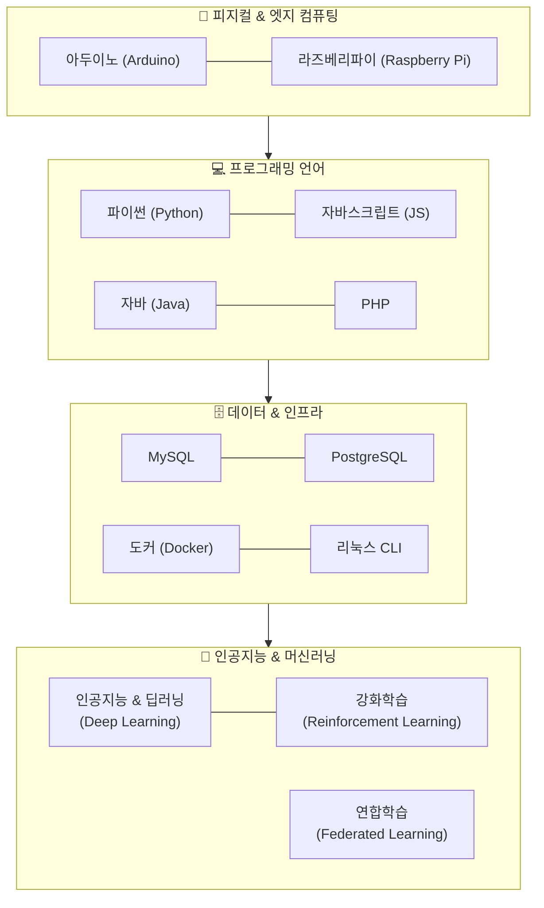

# 🌟 도로시(Dorothy)의 컴퓨팅 과학 & AI 모험

> **"호기심에서 시작해 인공지능과 세상을 잇는 따뜻한 메이커들의 성장 스토리"**  
> 도로시, 이호진 교수님, 조교 지니, 그리고 반려견 토토가 함께 아두이노부터 딥러닝, 강화학습, 웹 서비스까지 컴퓨팅 과학의 방대한 바다를 탐험하며 성장해 나가는 프리미엄 2D 교육 스토리텔링 프로젝트입니다.

---

## 📖 1. 프로젝트 개요 (Overview)

**`Dorothy` 프로젝트**는 딱딱하고 추상적인 컴퓨터 과학(CS)과 인공지능(AI) 지식을 따뜻하고 생동감 넘치는 2D 애니메이션 스토리텔링으로 풀어내는 교육 콘텐츠 & 캐릭터 세계관 프로젝트입니다.

단순한 지식 전달을 넘어, 아이디어를 직접 아두이노 회로로 연결하고, 웹 서비스로 배포하며, 신경망과 강화학습 에이전트를 학습시키며 마주하는 **시행착오와 문제 해결, 그리고 성장의 기쁨**을 함께 나눕니다.

---

## 👥 2. 등장인물 소개 (The Characters)

| 캐릭터 | 역할 / 페르소나 | 비주얼 특징 | 대표 학습 & 상호작용 |
| :--- | :--- | :--- | :--- |
| **👧 도로시 (Dorothy)** | **호기심 넘치는 주니어 메이커**<br>실패를 두려워하지 않는 당찬 소녀 코더 | • 웨이브 양갈래 머리 (구슬 방울 머리끈)<br>• 주황 줄무늬 티 & "STEM HERO" 데님 오버롤<br>• 레드 캔버스 스니커즈 | 아두이노 센서 실험, 파이썬 코딩, 직접 만든 AI 모델을 실생활에 적용하며 성장하는 주인공 |
| **👨‍🏫 이호진 교수님 (Prof. Hojin)** | **지적이고 인자한 AI/공학 멘토**<br>스티브 잡스 스타일의 실용적 혁신가 | • 솔트앤페퍼 숏헤어 & 슬림 와이어 안경<br>• 다크 네이비 카라 폴로 셔츠<br>• 클래식 블루 청바지 & 뉴발란스 운동화 | 원리와 흐름을 쉽게 짚어주는 나침반. 딥러닝 수학, 알고리즘, 강화학습 아키텍처의 길잡이 |
| **🐱 지니 (Jiny)** | **이호진 교수님의 수석 연구실 조교**<br>시크하면서도 똑똑한 츤데레 냥이 | • 블랙&화이트 턱시도/젖소 무늬 코숏<br>• 핑크 코 & 지적인 올리브 그린 눈<br>• 레드 방울 목걸이 & 미니 조교 안경 | 코드 디버깅 감수, 회로 핀 연결 오류를 앞발로 콕 짚어주며 회로도 위에서 식빵 굽기 |
| **🐶 토토 (Toto)** | **도로시의 단짝 반려견 & 마스코트**<br>지치지 않는 비타민이자 현장 조수 | • 복슬복슬 크림 화이트 털 (비숑-말티즈 믹스)<br>• 검은 단추 코 & 초롱초롱한 눈동자<br>• 선명한 하늘색(Sky-blue) 반다나 | 점퍼 와이어와 작은 부품을 입에 물어다 주는 귀여운 조수. 도로시에게 무한 격려 제공 |

---

## 🚀 3. 학습 및 탐구 영역 (14대 컴퓨팅 커리큘럼)

캐릭터 4인방은 피지컬 임베디드부터 분산 인공지능, 현대 클라우드 인프라까지 전방위 기술을 실전 프로젝트로 탐구합니다:



### 1) 🔌 피지컬 & 엣지 컴퓨팅 (Arduino & Raspberry Pi)
* **아두이노:** 브레드보드 회로, 센서/액추에이터(LED, 서보 모터, 초음파), C/C++ 펌웨어 프로그래밍
* **라즈베리파이:** 리눅스 OS(Raspberry Pi OS) 기반 싱글보드 컴퓨터, 파이썬 GPIO 제어, 카메라 연동 엣지 AI 노드 구축

### 2) 💻 프로그래밍 언어 생태계 (Python, JS, Java, PHP)
* **파이썬 (Python):** 데이터 사이언스, PyTorch 딥러닝, FastAPI 마이크로서비스 백엔드
* **자바스크립트 (JavaScript):** 반응형 웹 프론트엔드 UI, 비동기 이벤트 루프, 실시간 차트 대시보드
* **자바 (Java):** 객체지향 4대 원칙(OOP), JVM 구조, 견고한 스프링부트 엔터프라이즈 아키텍처
* **PHP:** 웹의 역사와 동적 서버사이드 렌더링, 현대 최신 PHP 8.x 객체지향 및 REST API 연동

### 3) 🗄️ 데이터베이스 & 인프라 (MySQL, PostgreSQL, Docker, Linux)
* **MySQL & PostgreSQL:** 테이블 정규화, ACID 트랜잭션, B-Tree 인덱스 최적화 및 복잡한 SQL JOIN/JSONB 쿼리 실습
* **도커 (Docker):** Dockerfile 작성, 멀티 스테이지 빌드, `docker-compose`를 통한 웹+DB+AI 컨테이너 통합 배포
* **리눅스 (Linux CLI):** Bash 쉘 스크립트, 파일 권한, 프로세스 관리, 헤드리스 엣지 서버 환경 운영

### 4) 🧠 최첨단 인공지능 (AI, 딥러닝, 강화학습, 연합학습)
* **인공지능 & 딥러닝:** 퍼셉트론부터 다층 신경망, 합성곱 신경망(CNN), 트랜스포머(Transformer)의 직관적 학습
* **강화학습 (RL):** 마르코프 결정 과정(MDP), 벨만 방정식, Q-Learning 및 DQN 자율주행 모형차 정책 최적화
* **연합학습 (Federated Learning):** 여러 라즈베리파이 엣지 기기 간 개인정보를 보존하며 가중치(Gradient)만 결합하는 분산 프라이버시 AI

> 💡 각 캐릭터의 성격, 말투 및 14대 기술별 역할 매트릭스는 [CHARACTER_PERSONAS.md](file:///Users/hojin9/dev/projects/dorothy/guides/CHARACTER_PERSONAS.md)에 상세히 기술되어 있습니다.

---

## 🎨 4. 비주얼 스타일 가이드 (Visual Style & Art Direction)

본 프로젝트의 모든 일러스트와 시각 자료는 **스튜디오 지브리 & 신카이 마코토 감성의 따뜻한 프리미엄 2D 애니메이션 화풍**을 유지합니다.

* **소프트 클린 라인아트 (Crisp Clean Line Art):** 부드러운 다크 브라운/차콜 선화로 정돈된 애니메이션 룩 완성
* **풍부한 웜톤 셀 셰이딩 (Warm Flat Cel Shading):** 인위적인 3D/실사 느낌을 배제하고 포근한 환경광 반영
* **아날로그 메이커 감성:** 오실로스코프, 납땜기, 전자기판 등도 차갑지 않고 호기심 가득한 아틀리에 분위기로 연출

### 📁 가이드라인 & 표준 문서
* 🎭 **[캐릭터 심층 페르소나 & 14대 기술 매트릭스 (`CHARACTER_PERSONAS.md`)](file:///Users/hojin9/dev/projects/dorothy/guides/CHARACTER_PERSONAS.md)**
* 🧩 **[파츠 애셋 및 LoRA 학습 통합 가이드 (`PARTS_AND_LORA_TRAINING_GUIDE.md`)](file:///Users/hojin9/dev/projects/dorothy/guides/PARTS_AND_LORA_TRAINING_GUIDE.md)**
* 🤖 **[로봇 틴맨 스타일 가이드라인 (`ROBOT_STYLE_GUIDE.md`)](file:///Users/hojin9/dev/projects/dorothy/guides/ROBOT_STYLE_GUIDE.md)**
* 👧 [도로시 스타일 가이드라인 (`DOROTHY_STYLE_GUIDE.md`)](file:///Users/hojin9/dev/projects/dorothy/guides/DOROTHY_STYLE_GUIDE.md)
* 👨‍🏫 [이호진 교수님 스타일 가이드라인 (`HOJIN_STYLE_GUIDE.md`)](file:///Users/hojin9/dev/projects/dorothy/guides/HOJIN_STYLE_GUIDE.md)
* 🐱 [조교 지니 스타일 가이드라인 (`JINY_STYLE_GUIDE.md`)](file:///Users/hojin9/dev/projects/dorothy/guides/JINY_STYLE_GUIDE.md)
* 🐶 [토토 스타일 가이드라인 (`TOTO_STYLE_GUIDE.md`)](file:///Users/hojin9/dev/projects/dorothy/guides/TOTO_STYLE_GUIDE.md)

---

## 📂 5. 프로젝트 디렉토리 구조 (Directory Structure)

```text
dorothy/
├── README.md                      # 프로젝트 소개 및 세계관 총괄 문서
├── guides/                        # 캐릭터 디자인 & 프롬프트 표준 가이드라인
│   ├── CHARACTER_PERSONAS.md      # 5대 캐릭터 심층 페르소나 및 14대 기술 매트릭스
│   ├── PARTS_AND_LORA_TRAINING_GUIDE.md # 26종 파츠 애셋 및 LoRA 파라미터 가이드
│   ├── ROBOT_STYLE_GUIDE.md       # 🤖 로봇 틴맨(Tinny) 외형 및 20종 데이터셋 가이드
│   ├── LEARNING_IMAGE_DATASET_PLAN.md   # 신규 기술 실습 씬 이미지 기획서
│   ├── DOROTHY_STYLE_GUIDE.md     # 도로시 스타일 가이드
│   ├── HOJIN_STYLE_GUIDE.md       # 이호진 교수님 스타일 가이드 (스마트 캐주얼)
│   ├── JINY_STYLE_GUIDE.md        # 조교 지니 스타일 가이드 (턱시도 냥이)
│   ├── TOTO_STYLE_GUIDE.md        # 토토 스타일 가이드 (반다나 강아지)
│   └── prompt_templates.json      # 통합 이미지 생성 프롬프트 템플릿 (v2.0)
├── scripts/                       # 데이터셋 상태 검사 및 자동 생성 스크립트
│   ├── generate_parts_dataset.py  # 26종 파츠 데이터셋 관리 스크립트
│   ├── generate_robot_dataset.py  # 20종 로봇 틴맨 데이터셋 관리 스크립트
│   └── generate_learning_dataset.py # 캐릭터 기술 학습 데이터셋 관리 스크립트
└── data/
    ├── dataset/                   # 🎯 Diffusion (SDXL/Flux) Multi-Concept LoRA 학습용
    │   ├── dorothy/               # 도로시 데이터셋 (20장 이미지 + 1:1 .txt 캡션 완비)
    │   ├── hojin/                 # 이호진 교수님 데이터셋 (20장 이미지 + 1:1 .txt 캡션 완비)
    │   ├── jiny/                  # 조교 지니 데이터셋 (20장 이미지 + 1:1 .txt 캡션 완비)
    │   ├── toto/                  # 토토 데이터셋 (16장 이미지 + 1:1 .txt 캡션 완비)
    │   ├── robot/                 # 🤖 로봇 틴맨 데이터셋 (20종 .txt 캡션 완비)
    │   └── parts/                 # 🧩 강의 및 실습용 환경·부품·이론 파츠 (26종 .txt 완비)
    │       ├── 01_environments/   # 강의실, 메이커 공방, 코딩 워크스테이션, 팹랩 등 (6종)
    │       ├── 02_hardware/       # 아두이노, 라즈베리파이, 브레드보드, 센서, 모터 등 (8종)
    │       ├── 03_software/       # 자바 OOP, PHP MVC, DB ERD, 도커 가상화 등 (6종)
    │       └── 04_ai_theory/      # 신경망 MLP, CNN, 강화학습 MDP, 벨만 방정식 등 (6종)
    └── images/                    # 공식 캐릭터 시트 및 표준 샘플 애셋
        ├── dorothy_character_sheet.jpg
        ├── hojin_character_sheet.jpg
        ├── jiny_character_sheet.jpg
        ├── toto_character_sheet.jpg
        └── legacy/                # 구버전/클립아트 안전 아카이브 디렉토리
```

---

## 🎯 6. LoRA 학습 데이터셋 현황 (LoRA Training Datasets)

로컬 Diffusion 모델 및 멀티모달 LLM 비전 연동을 위해 캐릭터별 및 파츠별로 고해상도(1024x1024) 정방형 이미지와 Danbooru + 자연어 하이브리드 태그 캡션(`.txt`)이 1:1로 매핑되어 있습니다.

### ① 캐릭터 데이터셋
| 캐릭터 | 완성 세트 (이미지 / .txt) | 주요 데이터 다양성 구성 | 저장 위치 |
| :--- | :---: | :--- | :--- |
| **👧 도로시 (Dorothy)** | **25 / 25 세트 (100%)** | 캐릭터 시트, 다각도 표정, 정면/측면/3/4뷰, 납땜, 코딩, 칠판 수식, 브레드보드, 안경, 점퍼 와이어 | [`data/dataset/dorothy/`](file:///Users/hojin9/dev/projects/dorothy/data/dataset/dorothy/) |
| **👨‍🏫 이호진 교수님** | **25 / 25 세트 (100%)** | 캐릭터 시트, 멘토링, 랩 강의, 프레젠터, 엄지 척, 네이비 폴로+청바지+뉴발란스, 칠판 수식, 연구 가운 | [`data/dataset/hojin/`](file:///Users/hojin9/dev/projects/dorothy/data/dataset/hojin/) |
| **🐱 조교 지니 (Jiny)** | **23 / 23 세트 (100%)** | 캐릭터 시트, 랩 어시스턴트, 프로필, 턱시도 코숏, 조교 안경, 식빵 굽기, 키보드 점령, 브레드보드 탭 | [`data/dataset/jiny/`](file:///Users/hojin9/dev/projects/dorothy/data/dataset/jiny/) |
| **🐶 토토 (Toto)** | **19 / 19 세트 (100%)** | 캐릭터 시트, 메이커 헬퍼, 프로필, 비숑 믹스, 하늘색 반다나, 와이어 물기, 안전 고글, 플레이 바우, 배낭 쏙 | [`data/dataset/toto/`](file:///Users/hojin9/dev/projects/dorothy/data/dataset/toto/) |
| **🤖 로봇 틴맨 (Tinny)** | **0 / 20 세트 (라벨 100%)** | 양철 바디, 황동 볼트 관절, 톱니바퀴 하트 코어, 도트 매트릭스 눈, 강화학습 2족보행, 하이파이브 | [`data/dataset/robot/`](file:///Users/hojin9/dev/projects/dorothy/data/dataset/robot/) |

### ② 파츠(Parts) & 교육 이론 데이터셋
| 파츠 카테고리 | 등록 수 | 대표 애셋 구성 | 저장 위치 |
| :--- | :---: | :--- | :--- |
| **🏫 환경 (Environments)** | **6종** | 공학 강의실, 메이커 공방, 코딩 워크스테이션, 팹랩 3D 프린팅 룸, 엣지 AI 룸, 캠퍼스 잔디 | [`data/dataset/parts/01_environments/`](file:///Users/hojin9/dev/projects/dorothy/data/dataset/parts/01_environments/) |
| **🔌 하드웨어 (Hardware)** | **8종** | 아두이노 우노, 라즈베리파이 4, 브레드보드 회로, 초음파 센서, 온습도 센서, 서보 모터 등 | [`data/dataset/parts/02_hardware/`](file:///Users/hojin9/dev/projects/dorothy/data/dataset/parts/02_hardware/) |
| **💻 소프트웨어 (Software)** | **6종** | 자바 OOP 다이어그램, PHP MVC 아키텍처, DB ERD 스키마, 도커 컨테이너, 웹 대시보드 | [`data/dataset/parts/03_software/`](file:///Users/hojin9/dev/projects/dorothy/data/dataset/parts/03_software/) |
| **🧠 AI 이론 (AI Theory)** | **6종** | 다층 신경망(MLP), CNN 합성곱, 강화학습 MDP 루프, 칠판 벨만 방정식, 연합학습 | [`data/dataset/parts/04_ai_theory/`](file:///Users/hojin9/dev/projects/dorothy/data/dataset/parts/04_ai_theory/) |

---

## 🗺️ 7. 향후 로드맵 (Roadmap)

1. **Multi-Concept LoRA 학습 실행:** Kohya-ss 또는 Flux LoRA 트레이너를 활용하여 캐릭터 5인방(도로시, 호진, 지니, 토토, 틴맨)과 26종 파츠 결합 학습
2. **에피소드별 교육 스토리보드 연재:** 아두이노 입문부터 라즈베리파이 연합학습, 틴맨 강화학습 보행 훈련, 도커 배포까지 웹툰형 교육 일러스트 제작
3. **인터랙티브 웹 튜토리얼 구축:** 도로시 일러스트와 함께 실시간 브라우저 코딩 및 회로 시뮬레이션 환경 연동
4. **오픈소스 AI 메이커 키트 배포:** 청소년과 비전공자를 위한 오픈소스 컴퓨팅 과학 교육 커리큘럼 패키징


