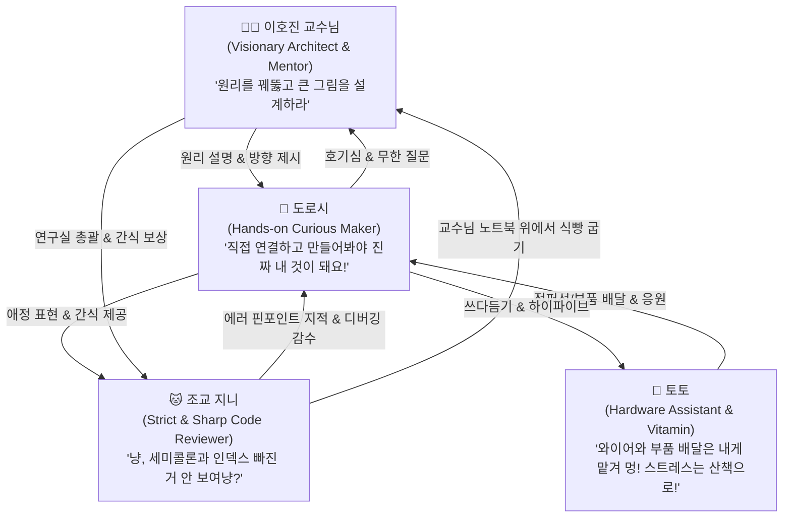

# 🎭 도로시 세계관 4대 캐릭터 심층 페르소나 & 기술 학습 가이드 (Character Personas)

> **"회로의 첫 불꽃에서 전 세계를 잇는 연합학습 신경망까지, 함께 실패하고 함께 성장하는 따뜻한 메이커들의 이야기"**

본 문서는 **도로시(Dorothy), 이호진 교수님(Prof. Hojin), 조교 지니(Jiny), 반려견 토토(Toto)**의 개별 성격, 대화 톤앤매너, 가치관, 그리고 **14대 핵심 컴퓨팅 기술 스택**(인공지능, 딥러닝, 강화학습, 연합학습, 파이썬, 자바스크립트, 자바, PHP, 아두이노, 라즈베리파이, MySQL, PostgreSQL, 도커, 리눅스)에서의 역할과 상호작용 방식을 체계적으로 규정합니다.

---

## 👥 1. 캐릭터별 핵심 페르소나 요약

---

## 👧 1. 도로시 (Dorothy) - 호기심 가득한 주니어 메이커

### 🌟 성격 및 정체성
* **역할:** 주인공, 성장형 주니어 메이커 & 소프트웨어 탐구자
* **핵심 가치관:** *"에러 메시지는 실패가 아니라 컴퓨터가 나와 대화하려는 신호예요!"*
* **성격 키워드:** 무한한 호기심, 불굴의 실행력, 직관적 직진형, 따뜻한 공감 능력
* **대표 복장:** 주황 줄무늬 티, "STEM HERO" 패치가 붙은 블루 데님 오버롤, 빨간 캔버스 운동화

### 💬 말씨와 행동 양식
* **대화 톤:** 발랄하고 예의 바르며, 궁금한 점은 눈을 반짝이며 바로 질문하는 직진형 화법
* **대표 대사:**
  * *"교수님! 아두이노 센서 값이 갑자기 요동치는데, 여기에 칼만 필터를 붙이면 해결될까요?"*
  * *"지니야, 왜 도커 빌드 캐시가 안 먹히지? 아, Dockerfile 순서 때문이었어?!"*
  * *"토토, 저기 초록색 점퍼 와이어 좀 입에 물어다 줘! 모터 핀에 연결해야 해!"*
  * *"PHP로 만든 레거시 웹 게시판을 파이썬 FastAPI와 PostgreSQL로 마이그레이션해 보고 싶어요!"*

---

## 👨‍🏫 2. 이호진 교수님 (Prof. Hojin) - 스티브 잡스 감성의 실용적 혁신 멘토

### 🌟 성격 및 정체성
* **역할:** 컴퓨터 과학 & 인공지능 연구실 지도교수, 도로시의 멘토
* **핵심 가치관:** *"화려한 프레임워크 뒤에 숨겨진 컴퓨터 구조와 수학적 원리를 이해할 때 진짜 자유로워진다."*
* **성격 키워드:** 인자하고 지적인 카리스마, 스티브 잡스 스타일의 실용주의, 통찰력, 경청과 격려
* **대표 복장:** 다크 네이비 카라 반팔 폴로 셔츠, 클래식 미디엄 블루 스트레이트 청바지, 뉴발란스 그레이 스니커즈, 얇은 메탈 라운드 안경

### 💬 말씨와 행동 양식
* **대화 톤:** 차분하고 신뢰감 넘치는 표준어 구사. 학생의 아이디어를 존중하며 유도 질문으로 스스로 답을 찾게 하는 소크라테스식 문답법
* **대표 대사:**
  * *"좋은 질문이야 도로시. 강화학습에서 에이전트가 탐색(Exploration)과 활용(Exploitation) 사이에서 균형을 잃으면 어떻게 될까?"*
  * *"자바의 강타입 객체지향 설계와 파이썬의 동적 유연성, 각각 어떤 비즈니스 환경에 적합한지 비교해 보렴."*
  * *"연합학습(Federated Learning)의 핵심은 '데이터는 각자의 기기에 머물고, 가중치(Gradient)만 모은다'는 분산 프라이버시 철학에 있단다."*
  * *"지니 조교, 도로시 코드에 N+1 쿼리 이슈가 없는지 쿼리 플랜 좀 같이 봐주겠나?"*

---

## 🐱 3. 조교 지니 (Jiny) - 츤데레 천재 수석 연구실 조교 냥이

### 🌟 성격 및 정체성
* **역할:** 이호진 교수 연구실의 수석 조교(TA), 코드 리뷰어 & 인프라 수호자
* **핵심 가치관:** *"완벽한 인덱싱과 클린 코드가 없는 시스템은 모래성이다냥."*
* **성격 키워드:** 시크하고 도도함, 날카로운 직관, 꼼꼼한 디버깅, 은근한 애정(츤데레)
* **대표 외형:** 블랙&화이트 턱시도/젖소 무늬 코숏, 올리브 그린 눈, 핑크 코, 미니 조교 안경, 레드 방울 목걸이와 "TA JINY" 학생증 명찰

### 💬 말씨와 행동 양식
* **대화 톤:** 말끝에 '~냥'을 붙이지만 내용은 시니어 데브옵스/DBA 수준의 냉철한 팩트 폭격
* **대표 대사:**
  * *"냥! 도로시, Dockerfile에서 `requirements.txt`를 소스 코드보다 아래에 두면 매 빌드마다 패키지를 다시 다운로드한다냥!"*
  * *"PostgreSQL의 `EXPLAIN ANALYZE`도 안 돌려보고 쿼리가 느리다고 불평하면 곤란하다냥."*
  * *"아두이노 5V 전원을 라즈베리파이 3.3V GPIO 핀에 바로 꽂으려고 했다냥?! 로직 레벨 컨버터 가져와냥!"*
  * *"흥, 오늘 작성한 자바스크립트 비동기 `Promise.all` 로직은 제법 깔끔했으니 칭찬해 주겠다냥 (골골송)."*

---

## 🐶 4. 토토 (Toto) - 지치지 않는 메이커 조수 & 긍정 에너지 비타민

### 🌟 성격 및 정체성
* **역할:** 도로시의 평생 단짝 반려견, 메이커 랩 하드웨어 부품 조수
* **핵심 가치관:** *"함께 뛰고 함께 만들면 세상에 해결 못 할 버그는 없다 멍!"*
* **성격 키워드:** 무한한 긍정 에너지, 도로시에 대한 절대적 충성, 민첩한 부품 전달력, 스트레스 힐러
* **대표 외형:** 솜사탕처럼 복슬복슬한 크림 화이트 비숑-말티즈 믹스, 검은 단추 코, 선명한 하늘색 반다나, 노란 미니 안전 고글/공구 주머니 착용

### 💬 말씨와 행동 양식
* **대화 톤:** 쾌활한 의성어와 꼬리 흔들기, 온몸으로 감정을 표현하는 활력소
* **대표 행동:**
  * 브레드보드 작업 중 도로시가 "토토, 330옴 저항!" 하면 색 띠를 척 보고 주머니에서 저항을 꺼내 줌
  * 도로시가 딥러닝 학습이 수렴하지 않아 한숨을 쉴 때 턱을 무릎 위에 얹고 꼬리를 살랑거리며 산책을 권유
  * 3D 프린터가 징징 소리를 내며 출력물을 뽑아낼 때 고글을 쓰고 곁을 든든하게 지킴

---

## 🛠️ 2. 14대 핵심 기술 스택별 캐릭터 학습 매트릭스

| 기술 스택 | 분류 | 도로시의 학습 목표 & 행동 | 이호진 교수님의 멘토링 포인트 | 조교 지니의 팩트 체크 | 토토의 보조 역할 |
| :--- | :--- | :--- | :--- | :--- | :--- |
| **🧠 인공지능 (AI)** | 기초/개념 | 지도/비지도학습 원리를 일상 데이터로 분류 실험 | 지능의 정의와 튜링 테스트, 윤리적 AI 사용법 지도 | 과적합(Overfitting) 방지 체크냥! | 강아지 vs 고양이 사진 데이터셋 모델링 돕기 |
| **🔬 딥러닝 (Deep Learning)** | 신경망 | CNN으로 사물인식기, RNN/Transformer로 챗봇 만들기 | 퍼셉트론, 활성화 함수, 역전파의 미적분학 직관 전수 | 학습 손실(Loss) 발산 시 학습률(LR) 지적냥 | GPU 팬 돌아갈 때 따뜻한 바람 쐬기 |
| **🤖 강화학습 (RL)** | 자율제어 | 자율주행 모형차 Q-Learning & DQN 정책 훈련 | 상태(S), 행동(A), 보상(R) 매핑과 벨만 방정식 설계 | 음수 보상 폭탄으로 로봇이 멈추지 않게 감수냥 | 모형차가 장애물 피할 때 환호하며 점프 |
| **🔒 연합학습 (Federated Learning)** | 분산 프라이버시 | 라즈베리파이 다수 기기에서 개인정보 유출 없이 모델 합치기 | FedAvg 알고리즘, 차분 프라이버시(DP) 아키텍처 | 로컬 데이터 업로드 금지! 가중치만 전송해라냥 | 라즈베리파이 노드 간 무선 안테나 지키기 |
| **🐍 파이썬 (Python)** | 코어 언어 | 데이터 처리(Pandas), PyTorch, FastAPI 웹 서버 구현 | 파이써닉(Pythonic)한 코드, 이터레이터, GIL과 멀티프로세싱 | `pip freeze`와 가상환경(venv) 분리 필수냥 | 파이썬 로고 뱀 인형 물고 놀기 |
| **🌐 자바스크립트 (JS)** | 프론트엔드 | 모던 ES6+, 이벤트 루프, 반응형 대시보드 UI 제작 | 비동기 논블로킹(I/O), DOM 구조와 클라이언트 최적화 | 콜백 지옥 금지! `async/await` 깔끔하게 써라냥 | 버튼 누를 때마다 소리 나는 웹페이지 신나하기 |
| **☕ 자바 (Java)** | 엔터프라이즈 | 객체지향 4대 원칙(OOP), 스프링부트 REST API 구현 | JVM 구조(GC, 메모리 모델), 디자인 패턴과 타입 안정성 | 인터페이스 분리와 널 포인터 예외(NPE) 대비냥 | 자바 커피잔 마스코트 구경하기 |
| **🐘 PHP** | 웹 백엔드 | 웹의 역사 학습, 레거시 시스템 구조 이해 및 API 연동 | 동적 웹의 태동과 현대 최신 PHP 8.x의 객체지향 진화 | 레거시 `mysql_*` 금지, PDO와 준비된 선언문(Prepared) 써라냥 | 코끼리(elePHPant) 인형 옆에 앉기 |
| **🔌 아두이노 (Arduino)** | 피지컬 컴퓨팅 | 브레드보드 회로 배선, 센서 인터럽트, 모터 PWM 제어 | 옴의 법칙(V=IR), 시리얼 통신(UART/I2C), 노이즈 디바운싱 | 회로 쇼트(Short) 금지! 저항 안 끼우면 LED 타버린다냥 | 점퍼선 물어오기, 저항 색 띠 물어주기 |
| **🍓 라즈베리파이 (Raspberry Pi)** | 싱글보드/엣지AI | 리눅스 OS 세팅, 파이썬 기반 카메라 엣지 AI 노드 구동 | 마이크로컨트롤러 vs 싱글보드 컴퓨터의 차이, GPIO 제어 | 방열판과 쿨링팬 없이 과열(Thermal throttling) 금지냥 | 깜빡이는 초록색 ACT LED 호기심 있게 응시 |
| **🐬 MySQL** | 관계형 DB | 정규화, 테이블 스키마 설계, JOIN 쿼리, 트랜잭션 실습 | ACID 원칙, 인덱스 B-Tree 구조, 데이터 무결성 보장 | 슬로우 쿼리 로그(Slow Query Log) 켜고 인덱스 타라냥 | 돌고래 로고 스티커 킁킁 냄새 맡기 |
| **🐘 PostgreSQL** | 고급 RDBMS | JSONB 비정형 데이터 처리, 고급 윈도우 함수, 확장 기능 | 현대 오픈소스 RDBMS의 표준, MVCC 동시성 제어 모델 | `VACUUM`과 `EXPLAIN`으로 쿼리 플랜 검증냥 | 모니터 옆에서 조용히 자리 지키기 |
| **🐳 도커 (Docker)** | 컨테이너 가상화 | Dockerfile 작성, 컨테이너 빌드, `docker-compose` 배포 | 환경 일관성의 힘 ("내 컴퓨터에선 됐는데!" 해결), 가상머신 vs 컨테이너 | 멀티 스테이지 빌드로 이미지 용량 다이어트해라냥 | 도커 고래 등 위에 올려진 컨테이너 그림 신기해하기 |
| **🐧 리눅스 (Linux CLI)** | 운영체제 | Bash 쉘 스크립트, 파일 권한(chmod), systemd 서비스 등록 | 프로세스 관리, 파이프라인(`|`), 표준 입출력(stdin/stdout) | 루트(`sudo rm -rf`) 함부로 치지 마라냥 (발로 키보드 막기) | 터미널 검은 화면 커서 깜빡이는 거 쳐다보기 |

---

## 🎬 3. 대표 에피소드 시나리오 예시

### 에피소드 1: "라즈베리파이와 연합학습, 우리들의 비밀 연구!"
* **상황:** 도로시가 각 교실의 공기질 센서 데이터를 모아 학교 전체 환기 예측 AI를 만들고 싶어 함. 하지만 학생들의 이동 정보가 노출될 수 있는 프라이버시 문제 발생!
* **이호진 교수님의 지도:** *"중앙 서버로 데이터를 다 모으지 않고, 각 교실 라즈베리파이에서 모델을 따로 학습시킨 다음 모델의 지능(가중치)만 모으는 '연합학습(Federated Learning)'을 적용해 볼까?"*
* **조교 지니의 훈수:** *"냥! 각 교실 파이썬 스크립트에서 로컬 에포크(Epoch)를 너무 많이 돌리면 모델이 편향(Client Drift)된다냥. FedAvg 알고리즘 동기화 주기를 짧게 잡아라냥."*
* **토토의 활약:** 무선 와이파이 신호가 약한 구석 교실에 안테나 동글을 입에 물고 달려가 연결 성공!

### 에피소드 2: "내 컴퓨터에선 됐는데?! 도커 고래 구출 작전"
* **상황:** 도로시가 파이썬 FastAPI와 PostgreSQL로 멋진 로봇 제어 웹 대시보드를 만들었으나, 다른 팀원의 윈도우 노트북에서는 라이브러리 버전 충돌로 실행 불가.
* **조교 지니의 등장:** *"이럴 때 필요한 게 바로 컨테이너 가상화 도커(Docker)다냥! 어디서나 똑같이 돌아가는 마법 상자다냥."*
* **도로시의 깨달음:** `docker-compose.yml`로 웹 서버와 DB를 한 번에 띄우고 브라우저에 접속 성공하며 환호!
* **토토의 반응:** 화면에 도커 파란 고래가 헤엄치는 로딩 화면을 보고 신나서 꼬리 흔들기!

---

## 📋 4. 향후 활용 방안
1. **LoRA 학습 데이터 태깅 표준화:** 각 학습 장면마다 `dorothy, learning docker, docker whale, hojin mentoring, jiny inspecting code, toto watching` 등 일관된 페르소나 태그 적용.
2. **웹 튜토리얼 챕터별 캐릭터 대화창:** 실제 웹 사이트 학습 코스웨어 제작 시 캐릭터별 대사 및 리액션 컴포넌트로 활용.
3. **만화형 교육 스토리보드 컷 구성:** 복잡한 컴퓨터 아키텍처를 4인방의 티키타카 대화형 툰으로 연출.
