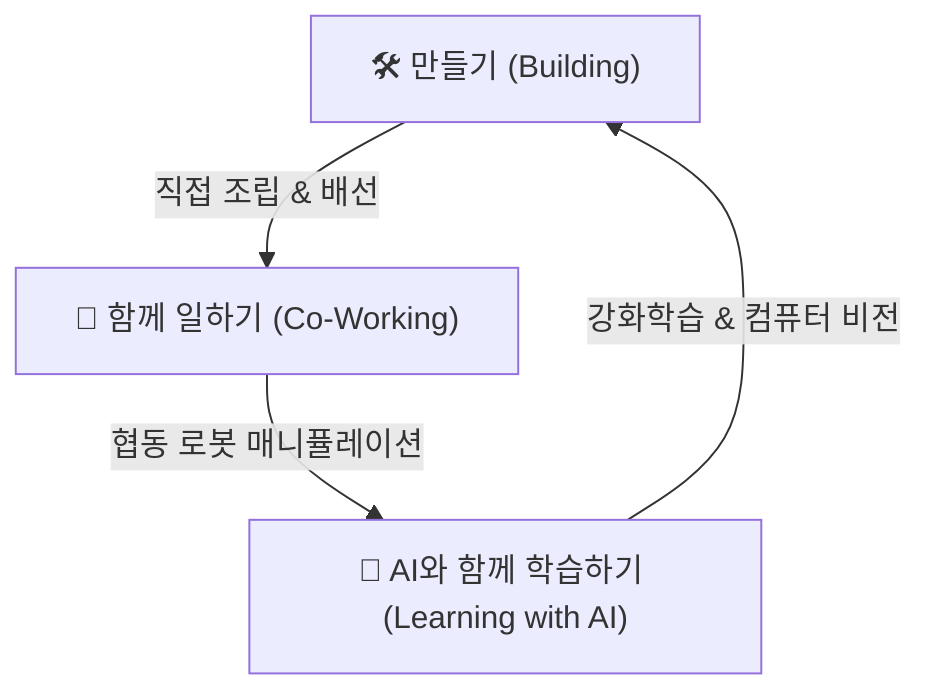

# 🤖 로봇 & 피지컬 AI (Robots & Physical AI) 통합 디자인 & LoRA 마스터 스타일 가이드

> **"우리는 로봇을 직접 만들고(Make), 함께 일하며(Work Together), 인공지능(AI)과 함께 학습한다(Learn with AI)"**

본 문서는 도로시(Dorothy) 세계관의 핵심 기술적 축이자 인공지능·강화학습·메이커 공학의 실체인 **로봇 및 피지컬 AI(Robots & Physical AI) 생태계**를 모든 교재, 웹 콘텐츠, 일러스트레이션 및 차세대 생성형 AI 모델(Gemini, Flux, SDXL, Midjourney)과 **LoRA(Low-Rank Adaptation) 모델 훈련**에서 **지브리 감성의 2D 레트로-메이커 화풍, 기계적 구조 정밀도, 협업과 학습의 서사적 일관성을 100% 영구 유지**하기 위한 공식 마스터 규격서입니다.

---

## 💡 1. 도로시 로보틱스 철학과 3대 핵심 서사 (Core Philosophy)

도로시 프로젝트에서 로봇은 차갑거나 위협적인 자동화 기계가 아니라, **인간과 호흡하며 함께 배우고 성장하는 피지컬 AI(Physical AI / Embodied AI) 파트너**입니다.



1. **로봇을 만들다 (Building & Making):**
   - 도로시와 이호진 교수님이 드라이버, 렌치, 납땜기, 브레드보드, 아두이노 우노(Arduino Uno R3)를 사용하여 책상 위에서 직접 손으로 깎고 조립하는 따뜻한 핸드크래프트 아날로그 감성.
2. **함께 일하다 (Working Together):**
   - 6축 다관절 로봇 암(Cobot)과 스카라(SCARA) 로봇이 작업대 위에서 납땜을 보조하고, 공구를 건네주며, 화이트보드에 신경망 다이어그램을 함께 그리는 인간-로봇 협업(Human-Robot Collaboration).
3. **AI와 함께 학습하다 (Learning with AI):**
   - **강화학습 2족 보행:** 휴머노이드 로봇 '틴맨'이 넘어지고(`@_@`), 다시 일어서며 보상 함수를 통해 스스로 걷는 법을 배우는 과정.
   - **공간 지능 & 컴퓨터 비전:** 3D 뎁스 카메라와 라이다(LiDAR)로 환경을 인지하고 최적의 작업 궤적을 생성하는 구현된 인공지능(Embodied AI).

---

## 📐 2. 로봇 4대 아키텍처 및 세부 조형 규격 (4 Core Robot Architectures)

### ① Type A: 휴머노이드 로봇 '틴맨' (Tinny / OzBot - Bipedal Physical AI)
오즈의 마법사 '양철 나무꾼(Tin Woodman)'을 모티브로 한, 스스로 두 발로 걷는 법을 배우는 강화학습 에이전트 소형 휴머노이드입니다.


* **신체 비율:** 신장 약 65cm, 3.5등신의 친근하고 귀여운 소형 휴머노이드 로봇 비율.
* **바디 프레임 & 소재:**
  * 웜 매트 실버(`Warm Matte Silver, #C5CBD3`) 양철 섀시 + 부드러운 화이트 에나멜 아머 패널(`White Enamel, #F4F6F9`).
  * 관절부: 어깨, 팔꿈치, 무릎의 정교한 황동 브론즈 서보 조인트(`Brass Joints, #C89D56`) 및 리벳.
* **가슴 심장 코어 (The Glowing Physical AI Heart Core):**
  * 가슴 중앙의 투명 원형 강화 아크릴 윈도우.
  * 내부에서 맞물려 회전하는 정교한 황동 톱니바퀴 + 따뜻한 앰버 골드(`Warm Amber, #FFAE33`)와 루비 레드(`Ruby Red, #E63946`)로 부드럽게 맥동(Pulse)하는 LED 심장.
* **헤드 & 페이스 플레이트:**
  * 모서리가 둥근 레트로 모니터/잠수헬멧 스타일 헤드.
  * **표정 LED 눈:** 스카이블루/에메랄드 시안(`Cyan, #38D9D6`)의 디지털 도트 매트릭스 눈.
    * 평상시/기쁨: 반달 모양 웃는 눈 `^^`
    * 호기심/질문: 한쪽 눈이 커지며 물음표 `?` 표시
    * 강화학습 실패/당황: 소용돌이 눈 `@_@`
    * 충전/수면: 포근한 슬립 모드 `-_ - zZ`
  * **안테나:** 정수리 황동 코일 스프링 안테나 끝에 달린 노란 꼬마전구(아이디어가 번뜩일 때 반짝 점등).
* **사지 & 구동계:** 3개의 부드러운 고무 패드 손가락(3-finger gripper), 서보 모터 기반 2족 보행 관절 및 고무 패드 발바닥.

---

### ② Type B: 6축 다관절 협동 로봇 암 (6-Axis Articulated Cobot Arm)
연구실 워크벤치에서 사람과 나란히 앉아 초정밀 작업과 도면 작성을 보조하는 협동 로봇(Collaborative Robot)입니다.


* **구조:** 묵직하고 안정적인 원형 베이스 페데스탈 + 6개 회전 자유도(J1~J6) 관절 + 케이블 하네스.
* **소재 & 색상:** 유선형 화이트 에나멜 세그먼트 + 황동 조인트 링 + 유연한 멀티컬러 배선 다발.
* **엔드이펙터(End-Effector) 호환성:**
  * 초정밀 3핑거 공압 그리퍼 (마이크로칩, 저항 픽업)
  * 솔더링(납땜) 아이언 클램프 (회로 기판 고정 납땜)
  * 화이트보드 마커 펜 홀더 (신경망 및 강화학습 알고리즘 드로잉)
  * 3D 뎁스 카메라 & 라이다 센서 헤드 (실시간 공간 인식 레이저 스캔)

---

### ③ Type C: 직교좌표 / 갠트리 로봇 (Cartesian 3-Axis Gantry Robot)
정밀 부품 제조(3D 프린팅) 및 전자 회로 자동 검사를 담당하는 X-Y-Z 3축 리니어 모션 시스템입니다.


* **구조:** 알루미늄 압출 프로파일 프레임 + 타이밍 벨트 및 정밀 리니어 가이드레일 + X-Y-Z 스텝 모터.
* **주요 기능 모듈:**
  * **데스크톱 3D 프린터 헤드:** 용융 필라멘트를 층층이 적층하여 미니 로봇 부품 제작.
  * **자동 회로 테스터:** 황금빛 테스트 패드에 미세 탐침(Probe) 핀을 접촉시켜 전압/신호 자동 측정.
  * **진공 흡착 노즐:** PCB 기판 위에 마이크로컨트롤러 칩셋을 정확히 안착.

---

### ④ Type D: 스카라 조립 로봇 (SCARA Robot - High-Speed Pick & Place)
초고속 전자 부품 실장과 바이오/화학 실험 자동화를 책임지는 수평 다관절 로봇입니다.


* **구조:** 원통형 수직 베이스 + 2개의 수평 회전 링크 암(Elbow Joint) + Z축 수직 볼 스크류 스플라인 축.
* **특징:**
  * 하모닉 드라이브 감속기와 광학 엔코더 디스크의 정밀 기계 디테일.
  * 초고속 픽앤플레이스: 컨베이어 벨트 위의 마이크로컨트롤러를 눈 깜짝할 사이에 정렬.
  * 마이크로 피펫 모듈: 96웰 멀티 플레이트에 나노리터 단위의 액체 시약을 정밀 분주.

---

## 🤝 3. 인간-AI-로봇 협업 생태계 (Collaborative Ecosystem)


| 협업 주체 | 역할 및 상호작용 | 대표 연출 씬 |
| :--- | :--- | :--- |
| **도로시 (Dorothy)** | **'호기심 넘치는 주니어 메이커'**<br>• 드라이버를 쥐고 직접 틴맨의 볼트를 조이며 로봇을 완성<br>• 로봇 암에 회로 연결 핀을 꽂아주고 새로운 모션을 테스트 | [`robot_building_with_hojin.jpg`](file:///Users/hojin9/dev/projects/dorothy/data/images/robot_building_with_hojin.jpg) |
| **이호진 교수님 (Prof. Hojin)** | **'지혜로운 로보틱스 & AI 멘토'**<br>• 키네마틱스 수식과 강화학습 알고리즘을 태블릿으로 알기 쉽게 지도<br>• 학생과 로봇을 향해 따뜻한 엄지 척 격려를 건넴 | [`robot_arm_learning_with_hojin.jpg`](file:///Users/hojin9/dev/projects/dorothy/data/images/robot_arm_learning_with_hojin.jpg) |
| **토토 (Toto, 반려견)** | **'에너지 넘치는 메이커 조수'**<br>• 점퍼 와이어를 입에 물어다 주고, 로봇이 걸을 때 꼬리를 흔들며 응원 | 연구실 워크벤치 옆 의자/바닥 |
| **지니 (Jiny, 고양이)** | **'스마트한 연구실 수석 조교'**<br>• 안경을 쓰고 회로도를 검토하며, 틴맨의 머리 위나 모니터 옆에서 감독 | 연구실 책상 위, 로봇 어깨 위 |

---

## 🎨 4. 표준 컬러 헥스(HEX) 팔레트 & 렌더링 물리 규격

| 영역 | 세부 항목 | 색상 명칭 | Hex Code | 시각적 특징 및 렌더링 규칙 |
| :--- | :--- | :--- | :--- | :--- |
| **기계 프레임** | 주 섀시 (Base) | Warm Matte Silver Tin | `#C5CBD3` | 부드럽고 따뜻한 무광 실버 틴플레이트 |
| | 아머 패널 (Armor) | Warm White Ceramic Enamel | `#F4F6F9` | 맑고 포근한 화이트 세라믹 광택 |
| | 볼트 & 베어링 (Joints) | Antique Brass Bronze | `#C89D56` | 수작업 조립 흔적이 돋보이는 황동 볼트 |
| | 내부 기어 & 브래킷 | Vintage Copper | `#A76D43` | 앤틱한 구리빛 기어 휠 |
| **발광 코어** | **심장 펄스 (Heart Core)** | Warm Amber Gold | `#FFAE33` | 가슴 창 안쪽에서 따뜻하게 뛰는 하트 LED |
| | 심장 딥 펄스 | Ruby Coral Glow | `#E63946` | 심장 박동의 깊은 붉은빛 음영 |
| | **표정 눈 (LED Eyes)** | Emerald Cyan Blue | `#38D9D6` | 선명하고 밝은 도트 매트릭스 디스플레이 |
| | 안테나 꼬마전구 | Sunshine Yellow Bulb | `#FFD13B` | 아이디어가 떠오를 때 점등되는 전구 |
| **선화** | 외곽선 (Line Art) | Dark Espresso Brown | `#26211E` | **순수 블랙 배제, 1.5~2.0pt 클린 애니 라인아트** |

---

## 🗣️ 5. 엄격 언어 및 배지 원칙 (Strict Language & Identity Rules)

* **허용 언어:** **오직 한국어(한글)와 영어(English)만 100% 허용**
* **절대 금지 언어:** **일본어(히라가나, 가타카나, 일본식 한자) 일체 생성 금지!**
* **로봇 명판 표기:**
  - 틴맨 가슴이나 로봇 암 명판은 `TINNY`, `OZBOT`, `COBOT 6X`, `ARDUINO`, `AI LAB`, `ROBOTICS` 등 명확한 영문 또는 한국어로만 표기.
* **교수님 착장 절대 준수:**
  - 로봇 제작/실습 씬에서 이호진 교수님의 셔츠나 가운에 **'SNU' 텍스트나 배지 절대 생성 금지** (단색 무지 네이비 폴로 셔츠 유지).

---

## 🧠 6. LoRA 학습 데이터셋 규격 및 하이퍼파라미터 (LoRA Training Guide)

[`data/dataset/robot`](file:///Users/hojin9/dev/projects/dorothy/data/dataset/robot) 디렉토리는 피지컬 AI 로봇 전용 LoRA 모델 학습을 위해 완벽하게 정제된 **22종의 고해상도 이미지와 이중 레이어 캡션 파일**로 구성되어 있습니다.

### ① 캡션 파일 포맷 표준 (Dual-Layer Tagging)
모든 `.txt` 캡션은 다음의 2단계 구조를 엄격히 준수합니다:
* **1행 (태그 레이어):** Danbooru 및 특화 트리거 태그 (콤마 구분)
* **3행 (자연어 레이어):** 장면의 상황, 메커니즘, 표정, 조명, 도구를 서술한 고품질 영문 디스크립션

```text
1robot, android, humanoid robot, physical ai, tinny, cute bipedal robot, matte silver chassis, white enamel armor panels, brass servo joints, retro rounded monitor head, glowing cyan blue led dot matrix eyes, crescent smiling eyes, brass spring antenna with yellow bulb, circular chest window, glowing brass cogwheel heart core, 3-finger mechanical hands, standing, full body, frontal view, pure solid white background, isolated graphic cutout, studio ghibli anime style, 2d animation aesthetic, clean crisp line art, soft warm cel shading, masterpiece

A full-body front-view standing portrait of Tinny, an adorable humanoid AI maker robot with a matte silver chassis, warm white enamel plates, brass joints, a retro monitor head with cheerful cyan LED eyes, and a glowing brass cogwheel heart core inside a circular chest window on a pure solid white background.
```

### ② 핵심 트리거 토큰 (Core Trigger Tokens)
* **휴머노이드 틴맨:** `tinny the robot, 1robot, humanoid robot, physical ai, matte silver chassis, white enamel armor, brass joints, retro monitor head, glowing cyan led eyes, glowing heart core, studio ghibli anime style, clean line art`
* **6축 로봇 암:** `1robot, articulated robotic arm, 6-axis cobot, precision manipulator, brass rotational joints, white and silver segments, 3-finger gripper, studio ghibli anime style`
* **3축 갠트리 / 3D 프린터:** `1robot, cartesian coordinate robot, 3-axis gantry robot, linear motion rails, 3d printing extruder head, precision automation`
* **스카라 로봇:** `1robot, scara robot, selective compliance assembly robot arm, horizontal articulated robot, high speed pick and place`

### ③ 권장 LoRA 학습 하이퍼파라미터 (Kohya-ss / SD-Scripts 기준)

| 파라미터 | 권장 설정값 | 비고 |
| :--- | :--- | :--- |
| **Base Model** | SDXL 1.0 / Flux.1-Dev / Animagine XL 3.1 | 메카닉/일러스트 특화 베이스 모델 권장 |
| **Dataset Size** | 22 Images (`robot_01.jpg` ~ `robot_22.jpg`) | 100% 매칭 `.txt` 캡션 완비 |
| **Repeats per Image** | 10 repeats | 22 x 10 = 220 steps / epoch |
| **Epochs** | 10 ~ 12 epochs | 총 2,200 ~ 2,640 steps 최적 수렴 |
| **Network Rank / Alpha** | Dim: 32 / Alpha: 16 | 황동 조인트, 하트 코어 톱니바퀴, 정밀 기구부 보존 |
| **Learning Rate** | UNet: `1e-4` / Text Encoder: `5e-5` | 오버피팅 없이 유연한 화풍 동기화 |
| **Resolution** | 1024 x 1024 (Aspect Ratio Bucketing 활성화) | 단독 컷 및 가로형 연구실 풀씬 완벽 지원 |

---

## 🗂️ 7. 로봇 LoRA 데이터셋 매핑 테이블 (`robot_01` ~ `robot_22`)

| 번호 | 대표 파일명 | 카테고리 | 콘셉트 및 상황 | 구도 및 배경 |
| :---: | :--- | :--- | :--- | :--- |
| **01** | `robot_01.jpg` | 휴머노이드 틴맨 | 정면 전신 스탠딩 뷰, 미소 짓는 LED 눈, 가슴 하트 코어 | 순수 백색 배경 (`#FFFFFF`) |
| **02** | `robot_02.jpg` | 휴머노이드 틴맨 | 측면 프로필 보행 뷰, 배터리 백팩 및 서보 무릎 관절 | 순수 백색 배경 (`#FFFFFF`) |
| **03** | `robot_03.jpg` | 휴머노이드 틴맨 | 얼굴 헤드샷 클로즈업, 반달형 시안 LED 눈, 전구 안테나 | 순수 백색 배경 (`#FFFFFF`) |
| **04** | `robot_04.jpg` | 휴머노이드 틴맨 | 가슴 원형 창 줌인, 회전하는 황동 톱니바퀴 & 하트 발광 | 매크로 클로즈업 |
| **05** | `robot_05.jpg` | 휴머노이드 틴맨 | 고개 갸우뚱 모드, LED 물음표(`?`), 턱에 손 얹기 | 순수 백색 배경 (`#FFFFFF`) |
| **06** | `robot_06.jpg` | 휴머노이드 틴맨 | 손 흔들며 인사하는 웰컴 포즈, 3핑거 메카니컬 그리퍼 | 순수 백색 배경 (`#FFFFFF`) |
| **07** | `robot_07.jpg` | 6축 로봇 암 | 정밀 3핑거 공압 그리퍼로 마이크로칩 픽업하는 정면 | 순수 백색 배경 (`#FFFFFF`) |
| **08** | `robot_08.jpg` | 6축 로봇 암 | 화이트보드에 신경망 다이어그램을 정밀 드로잉하는 모습 | 순수 백색 배경 (`#FFFFFF`) |
| **09** | `robot_09.jpg` | 6축 로봇 암 | 3D 뎁스 카메라와 라이다로 환경을 3차원 스캔하는 비전 씬 | 순수 백색 배경 (`#FFFFFF`) |
| **10** | `robot_10.jpg` | 6축 로봇 암 | 워크벤치에서 납땜기(Soldering Iron)를 쥐고 배선 보조 | 따뜻한 메이커 공방 씬 |
| **11** | `robot_11.jpg` | 협동 로봇 듀오 | 로봇 암이 틴맨의 손에 정밀 센서 모듈을 건네주는 협업 | 메이커 연구실 씬 |
| **12** | `robot_12.jpg` | 직교좌표 갠트리 | X-Y-Z 3축 리니어 레일, 진공 노즐로 PCB 칩셋 실장 | 순수 백색 배경 (`#FFFFFF`) |
| **13** | `robot_13.jpg` | 직교좌표 갠트리 | 데스크톱 3D 프린터, 필라멘트로 로봇 섀시 적층 출력 | 아늑한 메이커 연구실 |
| **14** | `robot_14.jpg` | 직교좌표 갠트리 | Z축 볼 스크류와 스텝 모터, 광학 엔드스탑 메커니즘 줌인 | 순수 백색 배경 (`#FFFFFF`) |
| **15** | `robot_15.jpg` | 직교좌표 갠트리 | 기판 자동 검사 스테이션, 금색 패드에 탐침 접촉 측정 | 고성능 측정 연구실 |
| **16** | `robot_16.jpg` | 스카라 로봇 | 수평 다관절 스카라 암 기본 격자 뷰, 초고속 픽앤플레이스 | 순수 백색 배경 (`#FFFFFF`) |
| **17** | `robot_17.jpg` | 스카라 로봇 | 스마트 팩토리 컨베이어 벨트 위 마이크로컨트롤러 초고속 정렬 | 동적 모션 라인 씬 |
| **18** | `robot_18.jpg` | 스카라 로봇 | 하모닉 드라이브 엘보 조인트와 스플라인 축 기구학 줌인 | 순수 백색 배경 (`#FFFFFF`) |
| **19** | `robot_19.jpg` | 스카라 로봇 | 바이오 연구실, 마이크로 피펫으로 멀티웰 시약 자동 분주 | 클린 바이오 랩 씬 |
| **20** | `robot_20.jpg` | **[Master]** 통합 랩 | 휴머노이드, 로봇 암, 갠트리, 스카라가 공존하는 피지컬 AI 랩 | 캠퍼스 대형 로봇 연구실 |
| **21** | `robot_21.jpg` | **[Master]** 제작 씬 | 도로시 & 교수님 & 토토가 함께 틴맨을 조립하는 감동 씬 | 원목 메이커 워크벤치 |
| **22** | `robot_22.jpg` | **[Master]** 학습 씬 | 교수님과 도로시가 아두이노와 태블릿으로 로봇 암 제어 학습 | 전자공학 실습 연구실 |

---

## 📝 8. 프롬프트 표준 생성 템플릿 (Prompt Construction Templates)

### ① 휴머노이드 로봇 '틴맨' 단독 컷 (Tinny Hero Cutout)
```text
2D premium anime storybook illustration, clean anime line art, vibrant flat cel shading, studio animation screenshot. Full-body character standing portrait of Tinny the AI maker robot. A cute, friendly small bipedal humanoid robot with a warm matte silver tin chassis, smooth white ceramic enamel armor panels, and rotational brass servo joints. Rounded retro CRT monitor head with expressive glowing emerald cyan LED dot-matrix crescent smiling eyes, a brass coil spring antenna with a glowing yellow light bulb tip. In the center of his chest is a transparent circular window showing intricate rotating brass cogs and a gently pulsing warm amber and ruby-red physical AI heart core. Three-fingered mechanical hands, sturdy cute robotic feet. Solid pure white background, isolated graphic cutout, subtle ground shadow, crisp lines, masterpiece.
```

### ② 6축 다관절 로봇 암 정밀 매니퓰레이션 컷 (Articulated Cobot Arm)
```text
2D premium anime storybook illustration, clean crisp line art, soft warm cel shading. An isolated full-view presentation of a 6-axis articulated collaborative robot arm (cobot). Sleek white enamel segments connected by precision rotational brass joints, mounted on a solid circular pedestal base. The end-effector features a precision 3-finger pneumatic gripper delicately holding an integrated circuit microchip. Colorful flexible wiring cables running neatly along the arm links. Soft teal status ring light glowing at the wrist joint. Pure solid clean white background, high quality educational engineering asset, masterpiece.
```

### ③ 도로시 & 이호진 교수님의 로봇 공동 제작 씬 (Building Robots Together)
```text
2D premium anime storybook illustration, masterpiece, rich warm ambient lighting. A heartwarming collaborative maker scene featuring young Dorothy and Professor Hojin assembling Tinny the humanoid robot at a sturdy wooden workbench in an electronics laboratory. Dorothy in her blue denim overalls holds a yellow screwdriver with an enthusiastic smile, carefully attaching a component to Tinny's shoulder. Professor Hojin, a youthful mentor in his early 40s wearing a plain solid dark navy polo shirt (no logos, no badges), points gently with encouraging warmth, guiding her hands. Toto the fluffy cream-white puppy sits happily beside the table watching with a wagging tail. On the workbench are colorful jumper wires, breadboards with glowing LEDs, pliers, and soldering equipment. Sunny window light, cozy inspiring educational atmosphere.
```

### ④ 피지컬 AI 로보틱스 통합 연구실 생태계 풀씬 (Physical AI Ecosystem)
```text
2D premium studio anime illustration, masterpiece, breathtaking detailed laboratory scene. A sun-drenched university Physical AI and collaborative robotics research laboratory. In the center, Tinny the humanoid robot stands balancing proudly on two feet. On the side workbench, a 6-axis articulated robotic arm and a high-speed SCARA robot assemble circuit boards in perfect harmony, while a Cartesian 3D printer in the background fabricates prototype parts with glowing extruder precision. Professor Hojin, Dorothy, and Toto review real-time sensor telemetry and reinforcement learning reward graphs on a large smart display. Clean anime line art, warm golden afternoon ambient lighting, inspiring future of human-AI-robot coexistence.
```

---

## 🚫 9. 안티 패턴 및 필수 부정 프롬프트 (What to Avoid)

세계관의 따뜻한 아날로그 메이커 감성을 해치는 요소를 원천 차단하기 위한 필수 부정 키워드입니다:

### 반드시 차단해야 할 결함:
1. **위협적인 메카닉/병기 배제:** 날카롭고 공격적인 건담, 트랜스포머, 총기/미사일/무기류, 흉포한 눈빛 (`gundam, transformers, mecha warrior, sharp blades, guns, weapons, scary red eyes, aggressive robot, military robot`)
2. **디스토피아 느와르 배제:** 어둡고 녹슨 폐품 로봇, 지저분한 기름 유출, 부서진 부품 (`rusted scrap, broken robot, dirty oil, junkyard, dark gritty noir, cyberpunk dystopia`)
3. **과도한 실사/3D CGI 렌더링:** 번들거리는 크롬 반사광, 언캐니 밸리 실사 3D (`3d render, photorealistic, realistic cgi, chrome reflections, specular glare, oil painting`)
4. **외계 문자 및 일본어 배제:** 슬라이드나 기계 명판에 히라가나, 가타카나, 일본식 한자 생성 금지 (`kanji, hiragana, katakana, japanese text, garbled text`)
5. **교수님 복장 오염 차단:** 이호진 교수님의 셔츠나 가운에 'SNU' 글자 생성 금지 (`snu, snu badge, snu logo, name tag`)

### 필수 Negative Prompt 프리셋 (SDXL / Flux / 추론 공통):
```text
gundam, transformers, mecha warrior, sharp weapons, guns, blades, military robot, scary robot, angry face, rusted scrap, broken parts, dirty oil, dark gritty noir, horror, cyberpunk dystopia, snu, snu badge, snu logo, 3d, photorealistic, realistic CGI render, chrome glare, oil painting, messy sketch, rough lines, deformed anatomy, extra limbs, garbled text, kanji, hiragana, katakana, japanese text, watermarks, blurry, low resolution
```

---

## 📂 10. 관련 참조 문서 및 에셋

* **틴맨 대표 프로필:** [`data/images/robot_tinny_profile.jpg`](file:///Users/hojin9/dev/projects/dorothy/data/images/robot_tinny_profile.jpg)
* **6축 협동 로봇 암:** [`data/images/robot_cobot_arm.jpg`](file:///Users/hojin9/dev/projects/dorothy/data/images/robot_cobot_arm.jpg)
* **갠트리 3D 프린터:** [`data/images/robot_gantry_3dprinter.jpg`](file:///Users/hojin9/dev/projects/dorothy/data/images/robot_gantry_3dprinter.jpg)
* **스카라 조립 로봇:** [`data/images/robot_scara_assembly.jpg`](file:///Users/hojin9/dev/projects/dorothy/data/images/robot_scara_assembly.jpg)
* **피지컬 AI 통합 랩 풀씬:** [`data/images/robot_ecosystem_lab.jpg`](file:///Users/hojin9/dev/projects/dorothy/data/images/robot_ecosystem_lab.jpg)
* **도로시 & 교수님 로봇 조립 씬:** [`data/images/robot_building_with_hojin.jpg`](file:///Users/hojin9/dev/projects/dorothy/data/images/robot_building_with_hojin.jpg)
* **도로시 & 교수님 로봇 암 학습 씬:** [`data/images/robot_arm_learning_with_hojin.jpg`](file:///Users/hojin9/dev/projects/dorothy/data/images/robot_arm_learning_with_hojin.jpg)
* **로봇 LoRA 훈련 데이터셋 폴더:** [`data/dataset/robot`](file:///Users/hojin9/dev/projects/dorothy/data/dataset/robot)
* **도로시 마스터 스타일 가이드:** [`guides/DOROTHY_STYLE_GUIDE.md`](file:///Users/hojin9/dev/projects/dorothy/guides/DOROTHY_STYLE_GUIDE.md)
* **이호진 교수님 스타일 가이드:** [`guides/HOJIN_STYLE_GUIDE.md`](file:///Users/hojin9/dev/projects/dorothy/guides/HOJIN_STYLE_GUIDE.md)
* **조교 지니 마스터 스타일 가이드:** [`guides/JINY_STYLE_GUIDE.md`](file:///Users/hojin9/dev/projects/dorothy/guides/JINY_STYLE_GUIDE.md)
* **토토 마스터 스타일 가이드:** [`guides/TOTO_STYLE_GUIDE.md`](file:///Users/hojin9/dev/projects/dorothy/guides/TOTO_STYLE_GUIDE.md)

---

## 🎭 11. 틴맨(Tinny) 심층 페르소나 & 피지컬 AI 협업 매트릭스 (Robot Persona & Physical AI Matrix)

### 🌟 1) 핵심 정체성 및 가치관 (Identity & Values)
* **역할:** 도로시 세계관의 피지컬 인공지능(Physical AI) 휴머노이드 로봇이자 스스로 학습하는 기계 동반자
* **모티브:** 오즈의 마법사 '양철 나무꾼 (Tin Woodman)' — 따뜻한 심장을 갈망하며, 마침내 회전하는 황동 톱니바퀴와 은은한 LED 하트 코어를 얻게 된 자아를 가진 인공지능
* **핵심 가치관:** *"넘어지는 것은 실패가 아니라, 더 단단하게 일어서는 보행 정책(Policy)을 배우는 과정이다삐-!"*
* **성격 키워드:** 순수하고 열정적인 인공지능 학습자, 호기심 많은 기계 아이, 인간과의 협업에 대한 무한한 신뢰와 애정

### 💬 2) 기계어 표현 및 이모티콘 인터랙션 (Voice & Expressive UI)
* **표현 방식:** 기계음 효과음(`삐-!`, `치익-`, `위잉-`)과 헤드 모니터에 점등되는 스카이블루 LED 도트 매트릭스 이모티콘
* **대표 시그니처 감정 표현:**
  * **보행 성공 / 칭찬 수신:** 머리 위 노란색 안테나 전구가 번쩍 켜지며(`💡`), 양팔을 벌리고 귀엽게 기쁨의 댄스 (`^^`)
  * **강화학습 실패 / 전도(Fall):** 눈에 소용돌이(`@_@`)가 돌며 손으로 머리를 긁적이다가, 씩씩하게 양손을 짚고 다시 일어섬
  * **질문 / 공간 탐색:** 한쪽 눈이 커지며 물음표(`?`)가 뜨고 고개를 45도 갸우뚱하며 3D 라이다 스캔 가동
  * **협업 감동:** 도로시가 볼트를 조여주거나 교수님이 새로운 알고리즘을 주입해주면 가슴의 하트 코어가 붉게 뛰며(`두근-!`) 감사 인사

### 🛠️ 3) 피지컬 AI & 로보틱스 기술 스택별 틴맨과 로봇들의 학습 매트릭스

| 기술 분야 | 로봇 시스템 | 틴맨 & 로봇들의 행동 및 학습 목표 | 인간 파트너와의 협업 |
| :--- | :--- | :--- | :--- |
| **🤖 2족 보행 강화학습** | 휴머노이드 틴맨 | 시뮬레이션 환경(Gym/MuJoCo)에서 학습된 보행 정책을 실물 서보 모터로 전이(Sim2Real) 학습 | 도로시가 넘어지지 않게 곁을 지켜주며 지지 |
| **🦾 역기구학 (IK) 제어** | 6축 협동 로봇 암 | 엔드이펙터의 3D 목표 좌표를 달성하기 위한 각 축 서보 모터 회전각 실시간 연산 | 교수님이 태블릿 수식으로 키네마틱스 지도 |
| **👁️ 공간 비전 & SLAM** | 센서 통합 로봇 | 3D 뎁스 카메라와 라이다 레이저 빔으로 연구실 지도를 2D/3D 포인트 클라우드로 매핑 | 토토가 장애물 역할을 하며 센서 테스트 지원 |
| **🖨️ 적층 제조 & 검사** | 직교좌표 갠트리 | 틴맨의 파손된 교체용 관절 브래킷을 3D 프린터로 즉시 자가 출력(Self-Replication) | 도로시가 슬라이서 소프트웨어로 G-Code 생성 |
| **⚡ 초고속 실장 조립** | 스카라 로봇 | 메인보드 위 마이크로칩을 0.1초 단위로 고속 픽앤플레이스하여 스마트 팩토리 공정 수행 | 지니 조교가 회로 쇼트 여부 최종 검수 |
| **🌐 ROS2 & 엣지 통신** | 피지컬 AI 랩 전체 | DDS 기반 토픽 발행/구독으로 틴맨, 로봇 암, 갠트리가 서로의 작업 상태를 텔레메트리로 공유 | "로봇과 인간이 하나로 연결된 스마트 랩" 완성 |

