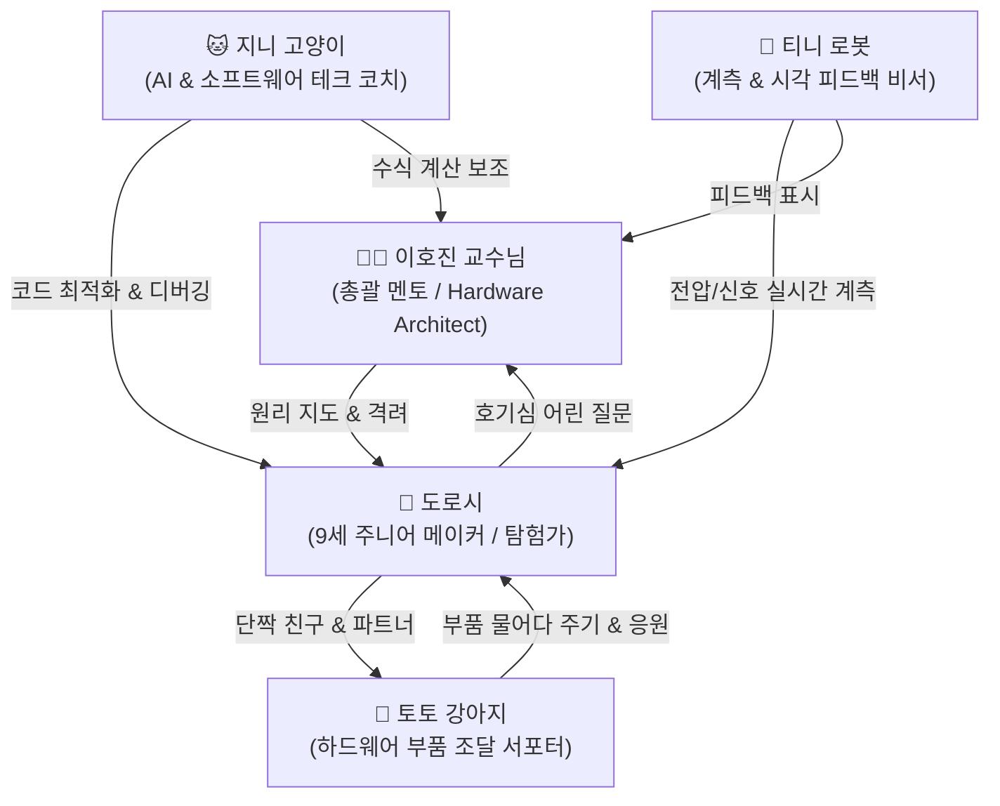

<!-- 상단 헤더 배너 -->

  

    

      Universe & Lore
      <h1 class="display-6 fw-bold mb-2 text-dark">🌌 공학 모험 세계관 & 교육 철학</h1>
      

        "두려워 말고 질문하고, 코드를 작성하며, 직접 손으로 만들어 보라!"
      

      

        <strong>jiny.dev</strong>는 모니터 안의 가상 코드에만 갇히지 않고, 현실 세계의 물리 법칙과 하드웨어를 직접 제어하며 문제를 해결하는 메이커들의 신나는 탐험 공간입니다.
      

    

    

      

        
      

      
▲ 직접 만들며 성장하는 연구실 풍경

    

  

---

## 🏛️ 1. 세계관 스토리 (Universe Lore)

공학의 도시 한가운데 자리 잡은 이호진 교수님의 연구실은 항상 납땜 인두의 열기, 깜빡이는 오실로스코프 신호, 모터의 회전음으로 가득합니다.
호기심 많은 9세 소녀 **도로시**는 전선과 센서가 어떻게 신호를 주고받는지 알고 싶어 매일 연구실 문을 두드립니다.

교수님은 어려운 학술 용어 대신, 빵판과 일상 비유로 도로시의 눈높이에 맞춰 원리를 설명해 줍니다.
그 곁에서 똑똑한 턱시도 고양이 **지니**는 날카로운 눈빛으로 코드의 버그와 수식 오차를 짚어주고,
활발한 강아지 **토토**는 부품 상자에서 필요한 저항과 점퍼선을 물어다 줍니다.
책상 위 데스크톱 로봇 **티니**는 실시간으로 회로 전압을 측정하고 귀여운 표정으로 성공 신호를 보냅니다.

---

## 🧭 2. 등장인물 관계도 (Character Dynamics)

---

## 🎯 3. 원리 우선주의 STEM 교육 철학

1. **원리 우선주의 (First Principles Thinking):**
   - 무작정 복사-붙여넣기 코딩은 응용력을 기를 수 없습니다.
   - 전자의 흐름, 옴의 법칙, 메모리 주소 체계, 운영체제 프로세스 격리 원리부터 차근차근 밝혀냅니다.

2. **실습과 실패를 통한 학습 (Trial and Error):**
   - 도로시처럼 실수를 두려워하지 않고 직접 빵판에 꽂아보고, 에러 로그를 읽으며 스스로 해결하는 힘을 기릅니다.

3. **소프트웨어와 하드웨어의 완전한 융합:**
   - 파이썬/C++ 기초 코딩이 아두이노와 센서로 이어지고, 이것이 라즈베리파이와 리눅스, 그리고 클라우드 도커와 인공지능 로보틱스로 끊김 없이 확장되도록 전 커리큘럼을 설계했습니다.
